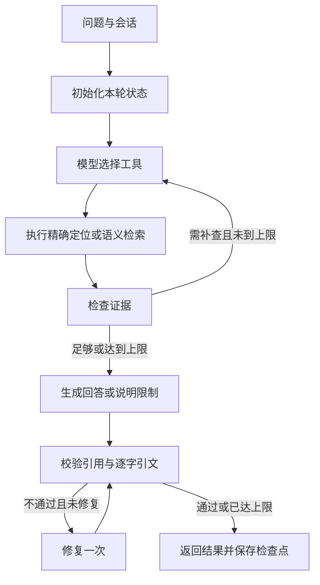

# 中国专利知识库助手

一个用于学习与简历展示的本地 Agentic RAG 项目。模型通过 LangGraph 选择条文定位或语义检索工具，检查依据，必要时补查，再生成带可核验引用的回答。

技术栈：**LangGraph + LangChain Responses + GPT-6 Astra + BGE-M3 + Chroma + SQLite + FastAPI + Streamlit**。

开发进度：[STATUS.md](STATUS.md)。配置说明：[CONFIGURATION.md](CONFIGURATION.md)。验证结果：[验证报告](reports/验证报告.md)。真实验证报告位于 [reports/](reports/)。问题集为 [eval/cases.json](eval/cases.json)。

## 资料与功能

| 用户提供资料 | 文件标注版本 | PDF 页数 |
|---|---|---:|
| 中华人民共和国专利法 | 2020 年修正 | 12 |
| 中华人民共和国专利法实施细则 | 2023 年修订 | 37 |
| 专利审查指南 | 2023 版 | 613 |

当前解析得到 82 条专利法、148 条实施细则和指南 38 章中的 1,272 个正文节点（含部分章首引入片段），共 **1,666 个检索片段**。指南 523 个正文页入库，封面、目录、空白页及末尾索引不作为重复正文入库。

- 条文定位和中文语义检索；指南支持“部分 / 章 / 节”的定位及下级小节召回。
- 最多两轮检索，每轮最多执行两个工具；引用不合格时最多修复一次。
- 每段事实关联本轮证据 ID，后端生成文档版本、条文位置和 PDF 物理页码。
- 会话绑定不可变知识库快照，SQLite 保存 LangGraph 检查点；追问重新检索。
- 页面支持查看证据、完整条文、小节原文、PDF 对应页及执行过程。
- 批量向量化可中断后续建；索引校验完成后才激活，旧会话仍可查看旧快照。

## 快速启动

已配置的这台电脑可直接运行：

```bash
cd "/Users/zhaomutian/Chinese_patent_agent"
.venv/bin/python scripts/serve.py
```

访问 <http://127.0.0.1:8501>；API 文档在 <http://127.0.0.1:8000/docs>。按 Ctrl-C 同时停止两个服务。只启动一个后端 worker；此初版为单机单并发应用。

首次安装：

```bash
# 本项目实测 Python 3.12.13；requires-python 为 >=3.11,<3.13。
UV_CACHE_DIR="$PWD/.uv-cache" uv sync --locked --python 3.12
cp .env.example .env
chmod 600 .env
# 在本地编辑 .env，填入对话平台地址、对话密钥、向量密钥。
.venv/bin/python -m patent_agent.cli doctor
.venv/bin/python -m patent_agent.cli doctor --live
```

`doctor` 不调用付费接口。`doctor --live` 会实际请求对话和向量模型，验证 Responses 普通输出、单/多工具调用回填、JSON、向量顺序和维度。错误报告不打印密钥、平台错误正文或私有对话地址。

## 准备或重建资料

原始文件和生成数据均被 Git 忽略。新设备需要自行放置用户提供的三份 PDF，并与 `config/sources.manifest.json` 中的路径和 SHA-256 对应。运行时使用应用根目录的 `.env`，不读取同级方案目录的配置。

PDF 文本提取需要 Poppler 的 `pdftotext`，macOS 可用 `brew install poppler`。首次接收的逐页提取存在时直接复用；`--reextract` 从原 PDF 重新生成提取。正式结构化正文仍由本项目解析器生成。

```bash
.venv/bin/python -m patent_agent.cli parse --reextract
.venv/bin/python -m patent_agent.cli index
```

`parse` 只读原 PDF，先校验哈希，保留物理页和提取到的印刷页脚标签，去除正文中的目录、页眉及页脚。当前解析器针对这三份 PDF 的版式开发；更换文件时应更新 manifest 并重新验证解析规则。

`index` 调用付费向量 API，以 10 条为一批写入新 collection。失败后重复执行同一命令会跳过已写入的向量。全部 ID 与数量一致后在 SQLite 事务内切换 active 快照。模型、维度、分块和解析版本改变会产生新快照。

## 命令行问答与验证

```bash
.venv/bin/python -m patent_agent.cli ask '专利法第二十二条规定了什么？'
# 用返回的 session_id 追问
.venv/bin/python -m patent_agent.cli ask '它对实用新型的要求呢？' --session <session_id>

.venv/bin/pytest -q
.venv/bin/ruff check src tests scripts
.venv/bin/python scripts/evaluate.py
```

最后一条命令会用真实模型执行 30 题，产生实际用量；按知识库快照和题目 ID 断点续跑，保存到 `reports/evaluation.jsonl`。要重新完整评测，先将旧报告改名归档。测试题和报告不包含 API 密钥。

工程测试覆盖真实语料的条号/章节/页码、向量响应校验、引用约束、工具与补查上限、多轮状态隔离、检查点恢复、接口与错误脱敏。语料相关测试需要本地资料和索引。

## 工作流



生成节点保留实际 AIMessage / ToolMessage 调用链，并限定可引用的证据 ID。只把检索文本重新包装成用户消息，可能导致模型将其视为用户自带材料；该问题已通过真实题集发现并修复，保留了修复前记录。

## 代码导航

| 文件 | 职责 |
|---|---|
| `settings.py` | `.env` 校验、敏感字段包装、绝对路径解析 |
| `models.py` / `doctor.py` | Responses 与 embedding 适配、可选付费诊断 |
| `ingest.py` | 三份 PDF 清洗、层级识别、页码映射及分块 |
| `storage.py` / `retrieval.py` | SQLite 目录、Chroma 快照及只读工具 |
| `agent.py` | LangGraph、状态隔离、证据检查与引用校验 |
| `api.py` / `ui.py` | FastAPI 服务及 Streamlit 页面 |
| `scripts/evaluate.py` | 固定题集真实调用与逐题记录 |

## 已知边界

1. 仅使用用户提供版本，未核验 2023 年以后的指南修改或其他法规变更，不能声称为最新法规库。
2. 文本提取不等于完整解析图片、化学结构、复杂公式或表格；有关页面应结合原 PDF。没有对 662 页逐页做人工法律审校。
3. 自动引用校验证明引用来自本轮正确快照、直接引文逐字存在；**不能证明每个解释都被原文充分支持**。最终语义质量需要逐题复核，报告不虚构法律问答准确率。
4. 语义检索使用向量距离与来源配额，尚无 BM25、专门 Reranker、法律效力优先级推理或跨版本对照。
5. 180 秒是节点前后检查和单次请求预算构成的协作式时间限制；底层网络/SDK 重试可能带来少量超时偏差，尚未实现进程级强制取消。
6. 当前是本地演示系统，无账户认证、远程部署、跨进程并发或生产级运维设计。应用数据、会话、索引及本地日志均不纳入 Git。

面试演示与可使用的简历表述见 [DEMO.md](DEMO.md)。
